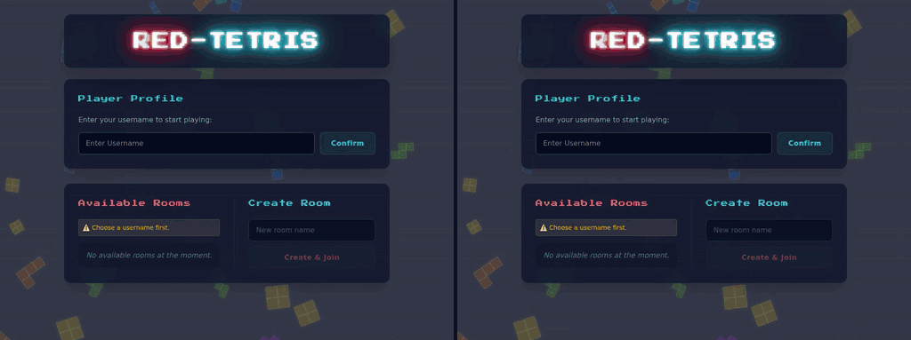

# 42-red-tetris

Networked multiplayer Tetris, built for the 42 `red-tetris` project: a Fastify + socket.io server serving a Svelte SPA.

## Features

- Real-time multiplayer rooms over socket.io: join with `/<room>/<player_name>`
- Classic Tetris gameplay

## Controls

| Action     | Keys                                       |
| ---------- | ------------------------------------------ |
| Move       | `←` `→` / `A` `D`                          |
| Rotate     | `↑` / `W`                                  |
| Soft drop  | `↓` / `S`                                  |
| Hard drop  | `Space`                                    |

WASD uses physical key positions, so it's ZQSD on an AZERTY keyboard.

## Install for dev

Using last version of node (25.9.0) and npm (11.12.1).
Using nvm to manage versions on 42 sessions.
Run as dev (two terminals):
- Backend: `cd server && npm install && npm run dev` (port 3000)
- Frontend: `cd client && npm install && npm run dev` (port 5173)

## Run (as served for evaluation)

From the repo root:
- `npm install`: installs the root, `server/` and `client/` dependencies
- `npm start`: builds the client into `client/dist` and starts the server, which serves `index.html`, `bundle.js` and the assets over HTTP, plus socket.io
- Open `http://<host>:<port>/` or directly `http://<host>:<port>/<room>/<player_name>`

Configuration (optional): copy `.env.example` to `.env` at the repo root (`HOST`, default `0.0.0.0`; `PORT`, default `3000`; `CLIENT_DIST`, default `client/dist`).

## Tests

- `npm test`: runs the server and client test suites
- `npm run coverage`: same, with coverage reports
